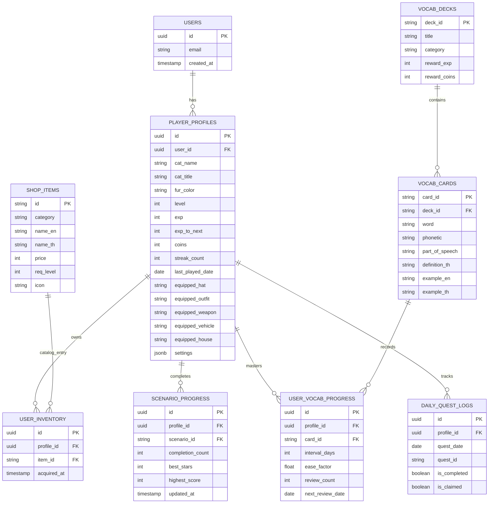

# MeowQuest: Daily English RPG (เหมียวเควสต์)
> **เว็บแอปพลิเคชันฝึกสนทนาภาษาอังกฤษในชีวิตประจำวันและการทำงาน ขับเคลื่อนด้วยระบบเกม RPG และน้องแมวสุดน่ารัก**  
> *ออกแบบตามหลักวิศวกรรมการศึกษา (EdTech), ทฤษฎีการเรียนรู้ภาษา (Second Language Acquisition), ระบบฉายาคนทำงาน (Lv. 1-20), และคลังการ์ดศัพท์ TOEIC / TOEFL / Business*

---

## 📖 สารบัญ (Table of Contents)
1. [ภาพรวมของระบบและหลักการออกแบบเกมเพื่อการศึกษา (EdTech Pedagogy)](#1-ภาพรวมของระบบและหลักการออกแบบเกมเพื่อการศึกษา)
2. [สถาปัตยกรรมระบบ Mobile-First & Web APIs](#2-สถาปัตยกรรมระบบ-mobile-first--web-apis)
3. [คลังด่านสถานการณ์จำลอง 10 ด่าน (10 Realistic Scenarios)](#3-คลังด่านสถานการณ์จำลอง-10-ด่าน)
4. [ระบบการพูดและโหมดเงียบ (Dual Interaction Engine) & ระบบสุ่มตัวเลือก](#4-ระบบการพูดและโหมดเงียบ-dual-interaction-engine--ระบบสุ่มตัวเลือก)
5. [ระบบฉายาเลเวลน้องแมวสไตล์คนทำงานออฟฟิศ (Workplace Titles Lv. 1 - 20)](#5-ระบบฉายาเลเวลน้องแมวสไตล์คนทำงานออฟฟิศ-workplace-titles-lv-1---20)
6. [ระบบการ์ดท่องศัพท์ระดับสากล TOEIC / TOEFL / Business (Interactive 3D Flashcards)](#6-ระบบการ์ดท่องศัพท์ระดับสากล-toeic--toefl--business-interactive-3d-flashcards)
7. [ระบบ RPG Gamification, การแต่งตัวแมว และเศรษฐกิจภายในเกม](#7-ระบบ-rpg-gamification-การแต่งตัวแมว-และเศรษฐกิจภายในเกม)
8. [การออกแบบระบบฐานข้อมูล (Database Schema & Architecture)](#8-การออกแบบระบบฐานข้อมูล-database-schema--architecture)
9. [การรีวิวเชิงลึกและแผนกลยุทธ์ยกระดับเพื่อแข่งขันกับแอปที่ต้องเสียเงิน (Competitive Roadmap)](#9-การรีวิวเชิงลึกและแผนกลยุทธ์ยกระดับเพื่อแข่งขันกับแอปที่ต้องเสียเงิน-competitive-roadmap)
10. [โครงสร้างไฟล์และวิธีรันโปรเจกต์](#10-โครงสร้างไฟล์และวิธีรันโปรเจกต์)

---

## 1. ภาพรวมของระบบและหลักการออกแบบเกมเพื่อการศึกษา

### 1.1 ปัญหาหลักของการฝึกภาษาอังกฤษทั่วไป (Pain Points)
- **ความกังวลในการออกเสียง (Affective Filter & Glossophobia):** ผู้เรียนมักกลัวการออกเสียงผิด กลัวสำเนียงไม่เป๊ะ ทำให้ปิดกั้นตนเองไม่กล้าพูด
- **ข้อจำกัดเรื่องสถานที่และการใช้งานบนมือถือ:** ผู้เรียนส่วนใหญ่หยิบมือถือมาเรียนระหว่างเดินทางบนรถไฟฟ้า ในร้านกาแฟ หรือก่อนนอน จึงต้องการ UI ที่กดง่ายด้วยนิ้วโป้งเดียว (One-Handed Thumb Reach) และไม่บังคับเปิดเสียง
- **ความเบื่อหน่ายและขาดความต่อเนื่อง (Dropout Rate):** แอปทั่วไปมักมีลักษณะเหมือนข้อสอบ เมื่อเรียนจบคอร์สแล้วไม่มีแรงจูงใจให้กลับมาเล่นซ้ำ
- **ความไม่สอดคล้องกับชีวิตทำงานจริง:** หลายแอปสอนประโยคเด็กๆ หรือประโยคที่แทบไม่ได้ใช้ในห้องประชุมหรือการติดต่อธุรกิจจริง

### 1.2 โซลูชันของ MeowQuest
1. **Mobile-First App-Like Experience:**
   - มี **Mobile Bottom Navigation Bar** ที่ติดอยู่ขอบล่างของหน้าจอบนสมาร์ตโฟน สลับระหว่าง Dialogue เควสต์, Vocab Flashcard, แมวของฉัน, ร้านค้า, เควสต์รายวัน ได้ด้วยนิ้วเดียว
   - มี **Haptic Touch Vibration** สั่นตอบสนองเบาๆ เมื่อแตะตัวเลือกและลูบน้องแมว (ผ่าน Web Vibration API)
2. **Low-Stress Interaction (โหมดเงียบเป็นหลัก - Silent First):**
   - ผู้เล่นสามารถเลือกตอบตัวเลือก หรือพิมพ์ประโยคตอบรับได้ทันที โดยยังคงได้เรียนรู้โครงสร้างประโยค ไวยากรณ์ และคำศัพท์ที่ถูกต้อง 100%
   - เมื่ออยู่ในสถานที่และเวลาที่พร้อม สามารถเปิด **"โหมดเสียงพูด (Voice Mode)"** เพื่อรับคะแนนพิเศษและโบนัส EXP
3. **ระบบสุ่มลำดับตัวเลือกแบบไดนามิก (Dynamic Option Shuffling):**
   - แก้ไขปัญหาตัวเลือกที่ถูกต้องอยู่ที่ข้อแรกเสมอ (Option A) โดยระบบใช้อัลกอริทึม Fisher-Yates / Random Shuffle ทุกครั้งที่โหลดบทสนทนา ทำให้ผู้เล่นต้องอ่านและคิดวิเคราะห์ความหมายจริงเสมอ
4. **Endless Daily Loop & Office Progression:**
   - สะสม EXP เลื่อนระดับตำแหน่งงานตั้งแต่ **"เด็กฝึกงานตาดำๆ"** สู่ **"ท่านประธานเหมียวพันล้าน"** พร้อมรับเหรียญ PawCoins แต่งตัวน้องแมว

---

## 2. สถาปัตยกรรมระบบ Mobile-First & Web APIs

```
D:\CatEnglishRPG/
├── index.html        # โครงสร้างหน้าเว็บ Semantic HTML5 รองรับ Viewport Fit, 3D Flashcards, Bottom Nav
├── style.css         # ดีไซน์ Mobile-First, Touch-Action Manipulation, 3D Flip Card, CSS Glassmorphism
├── scenarios.js      # คลัง 10 ด่านสถานการณ์จำลอง (รวมกว่า 41 คำถามสนทนาต่อเนื่อง) + Daily Quests Pool
├── vocab_decks.js    # คลังการ์ดคำศัพท์ระดับสากล TOEIC, TOEFL, Business พร้อมตัวอย่างประโยคประชุม/เอกสาร
├── app.js            # Engine หลัก: State Manager, Vocab Engine, Dynamic Option Shuffling, Audio Synth, Cat SVG
└── README.md         # เอกสารสถาปัตยกรรม, Game Design และแผนงานการพัฒนาเชิงธุรกิจ
```

---

## 3. คลังด่านสถานการณ์จำลอง 10 ด่าน (10 Realistic Scenarios)

ระบบได้รับการขยายเป็น **10 ด่านครอบคลุมการใช้ชีวิตจริง** โดยในแต่ละด่านมีคำถามแบบโต้ตอบต่อเนื่อง 4 - 5 คำถาม (Ping-Pong Conversation):

| # | ด่านจำลอง | หมวดหมู่ | จำนวนคำถาม | รายละเอียดการฝึกสนทนา |
| :---: | :--- | :--- | :---: | :--- |
| **1** | **The Whisker Cafe** ☕ | Ordering Food | **5 ข้อ** | สั่งลาเต้เย็น, เลือกนมข้าวโอ๊ต, สั่งหวานน้อยน้ำแข็งน้อย, เพิ่มครัวซองต์อุ่นร้อน, และชำระเงินด้วยบัตร |
| **2** | **Lost in Purr-is** 🗺️ | Navigation | **4 ข้อ** | ถามทางไปสถานีรถไฟใต้ดิน, ทวนทิศทาง, ถามระยะเวลาเดิน, และสอบถามการซื้อตั๋วที่ตู้ขายตั๋ว |
| **3** | **Paw-some Clinic** 🏥 | Healthcare | **4 ข้อ** | อธิบายอาการปวดหัวเจ็บคอมีไข้, บอกระยะเวลาและประวัติแพ้ยา, ถามวิธีทานยาก่อน/หลังอาหาร, และกล่าวขอบคุณแพทย์ |
| **4** | **Sunny Park Small Talk** 🌳 | Small Talk | **4 ข้อ** | ชวนคุยเรื่องสภาพอากาศ, แนะนำตัวว่ามาเที่ยวหรืออาศัยอยู่ที่นี่, แลกเปลี่ยนเรื่องงานอดิเรก, และบอกลาอย่างสุภาพ |
| **5** | **Grand Whisker Hotel** 🏨 | Travel | **4 ข้อ** | เช็กอินห้องพักตามชื่อจอง, ถามเวลาอาหารเช้าและรหัส Wi-Fi, ปฏิเสธการช่วยยกกระเป๋าอย่างสุภาพ, และยืนยันเวลาเช็กเอาต์ |
| **6** | **7-Meowven Store** 🏪 | Daily Shopping | **4 ข้อ** | ถามหาสายชาร์จมือถือ, ขอให้อุ่นไมโครเวฟข้าวกล่อง, ปฏิเสธถุงพลาสติก (นำถุงผ้ามาเอง), และสแกนจ่าย QR Code |
| **7** | **SkyPurr Airport** ✈️ | Travel & Border | **4 ข้อ** | ตอบคำถาม ตม. เรื่องวัตถุประสงค์การเข้าเมือง, แสดงหลักฐานการจองโรงแรม 7 วัน, ขอบคุณเจ้าหน้าที่, และถามหาเกต B12 |
| **8** | **MeowDonald's Drive-Thru** 🍔 | Ordering Food | **4 ข้อ** | สั่งเซ็ตชีสเบอร์เกอร์, เลือกเฟรนช์ฟรายส์กับโค้กซีโร่, ขอซอสบาร์บีคิวกับซอสมะเขือเทศเพิ่ม, และสั่งแบบ To go นำกลับบ้าน |
| **9** | **Police Lost & Found** 🎒 | Emergency & Help | **4 ข้อ** | แจ้งความกระเป๋าเป้หาย, บรรยายลักษณะสีและของข้างใน, ระบุสถานที่ลืมไว้เมื่อ 1 ชั่วโมงก่อน, และยืนยันบัตรรับของคืน |
| **10** | **CineMeow Theater** 🍿 | Entertainment | **4 ข้อ** | ซื้อตั๋วหนังเรื่อง Cat Adventure 2 ที่นั่ง, เลือกที่นั่งแถวกลางริมทางเดิน, สั่งชุดป๊อปคอร์นคาราเมลใหญ่, และถามทางไปโรง 3 |

---

## 4. ระบบการพูดและโหมดเงียบ (Dual Interaction Engine) & ฟีเจอร์ AI พัฒนาภาษาอังกฤษระดับมืออาชีพ

### 4.1 ระบบการโต้ตอบพื้นฐาน
- **Dynamic Option Randomization:** อัลกอริทึมจะสุ่มลำดับตัวเลือกใหม่ทุกครั้ง (`[...turn.options].sort(() => 0.5 - Math.random())`) ป้องกันการจำตำแหน่ง ช่วยให้ผู้เล่นโฟกัสกับเนื้อหาประโยคภาษาอังกฤษจริง
- **โหมดเงียบ (Silent Mode - Default):** กดเลือกตัวเลือก A/B/C ทันใจ เหมาะสำหรับเล่นบนรถไฟฟ้า หรือก่อนนอน พร้อมคำอธิบายเฉลยและเกร็ดคำศัพท์
- **โหมดเสียงพูด (Voice Mode - Optional):** รับฟังเสียงผู้เล่นผ่าน `webkitSpeechRecognition` พร้อมอัลกอริทึม Token-matching คำนวณ Accuracy % รับโบนัส EXP สูงสุด +100%
- **Web Audio API Sound Engine:** สังเคราะห์เสียง 8-bit, เสียงเหรียญทอง, เสียงเลเวลอัป, และเสียงครางเหมียวหวานๆ โดยไม่ต้องพึ่งพาไฟล์ภายนอก

---

### 4.2 ฟีเจอร์ AI พัฒนาภาษาอังกฤษระดับมืออาชีพ (Professional Language Enhancements)
1. 🎯 **Real-Time Pronunciation Heatmap (ระบบสแกนเสียงพูดรายคำ):**
   - เมื่อผู้เล่นพูดในโหมดเสียง ระบบจะไม่บอกแค่คะแนนรวม แต่จะไฮไลต์ประโยคเป็น **ชิปคำศัพท์ตามสี (Heatmap)**:
     - 🟢 **สีเขียว (Perfect):** ออกเสียงชัดเจน สำเนียงและพยัญชนะเป๊ะ
     - 🟡 **สีเหลือง (Near):** ใกล้เคียง ตรวจจับได้ว่าขาดเสียงท้ายคำ (Ending consonants เช่น `-s`, `-ed`, `-th`)
     - 🔴 **สีแดง (Miss):** ข้ามคำ หรือออกเสียงคลาดเคลื่อน
   - **Click-to-Drill:** ผู้เล่นสามารถใช้นิ้วแตะที่คำศัพท์สีแดง/เหลือง เพื่อฟังเสียงอ่านช้าแบบชัดถ้อยชัดคำ (0.75x Speed) พร้อมเคล็ดลับการออกเสียงจากน้องแมวได้ทันที
2. 👔 **Nuance & Politeness Coach (แมวติวเตอร์ระดับภาษา 3 ระดับ):**
   - ในหน้าเฉลยของแต่ละด่าน จะมีแถบพับเก็บ `💡 แมวติวเตอร์แนะวิธีพูดให้โปรขึ้น (3 Levels of Nuance)` แสดงประโยค 3 ระดับความสุภาพพร้อมปุ่มฟังเสียง 🔊:
     - **Casual (เป็นกันเอง):** เหมาะสำหรับคุยกับเพื่อน สนทนาทั่วไป
     - **Polite (สุภาพ):** เหมาะสำหรับร้านอาหาร โรงแรม หรือคุยกับคนไม่คุ้นเคย
     - **Executive (มืออาชีพ):** เหมาะสำหรับการประชุมงาน ติดต่อธุรกิจ หรือเขียนอีเมลทางการ
3. 📖 **Smart Spaced Repetition "สมุดจดจุดพลาดของน้องแมว" (Mistake Vault - SRS):**
   - ทุกครั้งที่ผู้เล่นตอบผิดในด่านบทสนทนา หรือออกเสียงไม่ผ่าน ระบบ AI หลังบ้านจะบันทึกประเด็นที่พลาดลงในสมุดทบทวนให้อัตโนมัติ
   - แสดงปุ่มกะพริบแจ้งเตือนที่แถบ Header: `[ 📖 จุดที่ต้องทบทวน: X ข้อ ]`
   - ผู้เล่นสามารถเปิดขึ้นมาทบทวนสั้นๆ 2 นาที เมื่อตอบถูกต้องคำนั้นจะถูกปลดออกจากสมุดทันที พร้อมรับรางวัล **+15 EXP**
4. 🎧 **60-Second Daily Listening Podcast (วิทยุแมวฟังบทสนทนาสั้น 1 นาที):**
   - ปุ่มไอคอนหูฟังที่แถบ Header เปิดฟังบทสนทนาภาษาอังกฤษสั้น 1 นาที เช่น กาแฟยามเช้า, ประกาศในสนามบิน, เปิดประชุมผู้บริหาร
   - แสดงซับไตเติลภาษาอังกฤษและแปลไทยแบบคาราโอเกะ ไฮไลต์ตามเสียงพูดแบบเรียลไทม์ พร้อมปุ่มปรับความเร็วเสียง (1.0x / 0.8x) ฟังจบรับโบนัส **+20 EXP และ +10 🪙**

---

## 5. ระบบฉายาเลเวลน้องแมวสไตล์คนทำงานออฟฟิศ (Workplace Titles Lv. 1 - 20) & ศูนย์ดูแลคู่หูแมวเหมียว

### 5.1 ฉายาแสดงอยู่ตรงไหนในแอปพลิเคชัน? (Prominent Placement)
เพื่อให้น้องแมวและฉายาโดดเด่นตลอดเวลา ไม่หลบซ่อนอยู่ในแท็บ ระบบจึงแสดงฉายาและตัวละครหลักใน **4 จุดสำคัญแบบเรียลไทม์**:
1. **Header Mini Cat Status Pill (แถบด้านบนสุด - ติดตามทุกหน้าจอ):**
   - แสดง Avatar หน้าแมว, ชื่อแมว และเข็มกลัดฉายา เช่น `[🐱 Mimi: เด็กฝึกงานตาดำๆ 🍼]` พร้อมไฟเขียวสถานะอารมณ์ดี คลิกเพื่อกระโดดไปห้องแต่งตัวหรือลูบน้องได้ทันที
2. **Hero Cat Companion Sanctuary (การ์ดเด่นสง่าหน้าแรกของแท็บออกสำรวจ):**
   - น้องแมวตัวใหญ่ยืนต้อนรับอยู่หน้าบ้านพัก พร้อมบอลลูนคำพูดให้กำลังใจประจำวัน
   - มี **ป้ายฉายาเรืองแสงสีทอง-ส้ม** ขนาดใหญ่พิเศษ `[ เด็กฝึกงานตาดำๆ 🍼 (Intern Kitten) ]`
   - แถบ **Career Milestone Tracker:** แสดงชัดเจนว่า *"ตำแหน่งปัจจุบัน: Lv. 1"* และ *"🎯 เลเวลถัดไป: พนักงานทดลองงานสายลุ้น 🐣 (Lv. 2)"* พร้อมแถบเปอร์เซ็นต์และ EXP ที่ต้องเก็บเพิ่ม
3. **Stage Dialogue Arena (ในด่านบทสนทนา):**
   - ป้ายกำกับตัวละครแมวฝั่งผู้เล่นแสดงชื่อและฉายาชัดเจน: `🐱 Mimi • เด็กฝึกงานตาดำๆ 🍼`
4. **Vocab Flashcard Cheerleader (ในหน้าการ์ดศัพท์):**
   - มีน้องแมวยืนเชียร์อยู่ข้างๆ พร้อมข้อความให้กำลังใจในการจำศัพท์เพื่อเลื่อนขั้น

### 5.2 ระบบดูแลคู่หูแมวเหมียวเสมือนจริง (Tamagotchi Pet Care Loop)
- **💖 ระดับความสุข (Happiness Bar):** ลูบหัวหรือเกาคางเพื่อเติมความสุขให้เต็ม 100% มีเสียงครางเพอร์ (Purr) และหัวใจลอย
- **🐟 ความอิ่มท้อง & การป้อนขนม (Fullness Bar & Treat Feeding):**
  - กดปุ่ม **"🐟 ป้อนขนม (+15 EXP)"** เพื่อป้อนปลาทูหรือขนมแมวเลีย (ฟรีวันละ 1 ครั้ง หรือใช้ 5 PawCoins)
  - น้องแมวเคี้ยวหงุบหงับ เพิ่มความอิ่ม 100% และมอบโบนัส **+15 EXP ทันที!**
- **💬 บอลลูนคำพูดไดนามิก:** เปลี่ยนข้อความตลกๆ ให้กำลังใจคนทำงานสลับเปลี่ยนตามการลูบและป้อนอาหาร

### 5.3 ตารางระดับขั้นและฉายาของน้องแมว (Lv. 1 - 20)

เพื่อสร้างอารมณ์ขันและกระตุ้นแรงจูงใจสไตล์วัยทำงาน (Office Worker Life Simulation) น้องแมวจะได้รับฉายาเลื่อนขั้นตามระดับเลเวล 1 ถึง 20:

| Level | ฉายาภาษาไทย (Office Title) | English Title | Badge & อารมณ์ฉายา |
| :---: | :--- | :--- | :--- |
| **Lv. 1** | **เด็กฝึกงานตาดำๆ** 🍼 | Intern Kitten | น้องใหม่เพิ่งเข้าออฟฟิศ เดินงงๆ ในดงเอกสาร |
| **Lv. 2** | **พนักงานทดลองงานสายลุ้น** 🐣 | Probation Kitty | 119 วันแห่งความหวัง กินกาแฟวันละ 3 แก้ว |
| **Lv. 3** | **เจ้าหน้าที่จดรายงานการประชุมมือไว** 📝 | Minute-Taking Cat | พิมพ์เร็วกว่าเสียง ประชุม 2 ชั่วโมง สรุป 5 หน้า |
| **Lv. 4** | **แอดมินสายไฟท์ ตอบแชทสู้ชีวิต** 💬 | Support Fighter | ลูกค้าทักปุ๊บ ตอบปั๊บ พร้อมมีมสู้ชีวิต |
| **Lv. 5** | **พนักงานประจำผู้รอดชีวิตจากช่วงโปร** 👔 | Confirmed Staff Cat | พ้นโปรแล้ว! ซื้อชาไข่มุกฉลองให้ตัวเอง |
| **Lv. 6** | **ซีเนียร์แบกทีมหลังแอ่น** 🎒 | Senior Back-Carrier | น้องๆ มีปัญหาอะไร โยนมาหาพี่ได้เลย |
| **Lv. 7** | **หัวหน้าทีมสายซัพพอร์ต** 🛡️ | Supportive Team Lead | สู้เพื่อสวัสดิการลูกทีม ไม่กินหัวน้องในทีม |
| **Lv. 8** | **ผู้เชี่ยวชาญการชงสไลด์แก้รอบที่แปด** 📊 | Slide Pitching Specialist | เปลี่ยนสีฟอนต์ตามใจลูกค้า ครั้งที่ 8 ยังไหว |
| **Lv. 9** | **โปรเจกต์เมเนเจอร์ตามจิกทุกเดดไลน์** ⏱️ | Deadline Tracker PM | "งานนี้เสร็จกี่โมงคะพี่?" ถามด้วยรอยยิ้มหวาน |
| **Lv. 10** | **ผู้จัดการแผนกผู้มีประชุมทั้งวันทั้งคืน** 💼 | Meeting Marathon Manager | คิวในปฏิทินเต็มเอี๊ยด หาเวลาทานข้าว 15 นาที |
| **Lv. 11** | **รองผู้อำนวยการสายกลยุทธ์เหนือเมฆ** 🧭 | Strategic Associate Director | นั่งมองภาพรวม 5 ปีข้างหน้า พูดแต่เรื่อง Synergy |
| **Lv. 12** | **ผู้อำนวยการใหญ่เซ็นอนุมัติงบพันล้าน** 🖋️ | Executive Director | ตวัดปากกาทีเดียว บัดเจ็ตไหลมาเทมา |
| **Lv. 13** | **รองประธานฝ่ายแก้ปัญหาฉุกเฉินระดับโลก** 🌐 | Global VP of Crisis | ไฟไหม้งานที่ไหน เหมียวบินไปดับถึงที่ |
| **Lv. 14** | **ผู้บริหารระดับสูงสายวิสัยทัศน์พันล้าน** 👁️ | C-Level Visionary | กำหนดทิศทางธุรกิจ พาน้องเหมียวบุกตลาดโลก |
| **Lv. 15** | **ซีอีโอเหมียวสุดคูล นั่งจิบกาแฟชมวิวเพนท์เฮาส์** ☕ | Cool Meow CEO | ชีวิตดี๊ดี บริหารงานผ่านไอแพดและวิสัยทัศน์ |
| **Lv. 16** | **ประธานบอร์ดบริหารผู้กุมชะตากรรมออฟฟิศ** 👑 | Board Chairman Cat | ชี้นิ้วตัดสินทิศทาง ทุกคนในบอร์ดต้องปรบมือ |
| **Lv. 17** | **ที่ปรึกษาอาวุโสกิตติมศักดิ์ที่เข้าบอร์ดเดือนละครั้ง** 📜 | Honorary Advisor | เข้าออฟฟิศเดือนละครั้ง ทุกคนโค้งคำนับ |
| **Lv. 18** | **ผู้ถือหุ้นรายใหญ่ที่นอนนับเงินปันผลอยู่บ้าน** 💎 | Major Shareholder Cat | Passive income ไหลเข้ากระเป๋า นอนดูแมวเล่น |
| **Lv. 19** | **ตำนานผู้ก่อตั้งอาณาจักรธุรกิจเหมียว** 🏛️ | Empire Founder Legend | รูปปั้นทองคำตั้งอยู่หน้าสำนักงานใหญ่ |
| **Lv. 20** | **ท่านประธานเหมียวพันล้านแห่งกาแล็กซี** 🪐✨ | Legendary Billionaire Chairman | ระดับสูงสุด สิทธิประโยชน์และของแต่งกายระดับพระเจ้า |

---

## 6. ระบบการ์ดท่องศัพท์ระดับสากล TOEIC / TOEFL / Business (Interactive 3D Flashcards)

ยกระดับความรู้ภาษาอังกฤษให้พร้อมใช้งานจริงทั้งการสอบระดับสากล และการทำงานร่วมกับองค์กรข้ามชาติ:

```
┌──────────────────────────────────────────────────────────────┐
│  [ TOEIC Master (800+) ]  [ TOEFL Academic ]  [ Executive Biz ]  │
├──────────────────────────────────────────────────────────────┤
│                                                              │
│     ┌──────────────────────────────────────────────────┐     │
│     │  Deck: TOEIC Master (800+)       [Card 1 of 6]   │     │
│     │                                                  │     │
│     │  Word:    feasible  🔊 (US Pronunciation)        │     │
│     │  Phonetic: /ˈfiː.zə.bəl/                         │     │
│     │  Type:    adjective                              │     │
│     │                                                  │     │
│     │  [ แตะการ์ดเพื่อพลิกดูความหมายและตัวอย่าง ]        │     │
│     │  ----------------------------------------------  │     │
│     │  ความหมาย: เป็นไปได้ในทางปฏิบัติ, คุ้มค่าที่จะทำ    │     │
│     │  Collocation: feasible solution / feasible plan  │     │
│     │                                                  │     │
│     │  💼 Workplace Meeting / Memo Example:            │     │
│     │  "Based on the quarterly budget report,          │     │
│     │   launching the new marketing campaign in Q3     │     │
│     │   is fully feasible." 🔊                         │     │
│     │  (จากรายงานงบประมาณรายไตรมาส การเปิดตัวแคมเปญ... )   │     │
│     └──────────────────────────────────────────────────┘     │
│                                                              │
│       [ 🔄 ยังจำไม่ได้ (ทบทวน) ]    [ ✅ จำได้แม่นยำ! (Next) ]      │
└──────────────────────────────────────────────────────────────┘
```

### 6.1 รายละเอียดชุดคำศัพท์
1. **TOEIC Master Deck (เน้นการประชุม, การจัดการ, การเงิน, การตลาด):**
   - คำศัพท์: *feasible, negotiate, agenda, implement, discrepancy, confidential*
   - ประโยคตัวอย่าง: จำลองจากอีเมลทางธุรกิจ, สรุปการประชุมผู้บริหาร, เอกสารตรวจสอบงบประมาณ
2. **TOEFL Academic & Professional Deck (เน้นการวิเคราะห์, การให้เหตุผล, ตรรกะ):**
   - คำศัพท์: *corroborate, comprehensive, unprecedented, ambiguous, scrutinize, consolidate*
   - ประโยคตัวอย่าง: รายงานการวิจัยตลาด, การตรวจสอบข้อมูลก่อนอนุมัติโครงการ, การควบรวมกิจการ
3. **Executive Business Deck (เน้นคำศัพท์ระดับผู้บริหาร, กลยุทธ์, การเจรจา):**
   - คำศัพท์: *synergy, benchmark, leverage, contingency, streamline, delegate*
   - ประโยคตัวอย่าง: การปรับโครงสร้างองค์กร, แผนรองรับความเสี่ยงฉุกเฉิน, การมอบหมายงานลูกทีม

### 6.2 กลไกการเชื่อมโยงระบบเศรษฐกิจ (Economy & Reward Connectivity)
- **Speech Synthesis TTS:** สามารถกดไอคอน 🔊 เพื่อฟังสำเนียงเจ้าของภาษาได้ทั้งระดับคำศัพท์เดี่ยว และประโยคตัวอย่างในที่ทำงาน
- **Interactive 3D Flip Card:** พลิกการ์ดหน้า-หลังด้วย CSS 3D Transforms (`rotateY(180deg)`) ไหลลื่น
- **Deck Completion Reward:** เมื่อฝึกการ์ดศัพท์จนครบชุด จะได้รับรางวัล **+50 EXP** และ **+35 PawCoins** ทันที พร้อมเอฟเฟกต์พลุเฉลิมฉลองและเสียง 8-bit Win Jingle

---

## 7. ระบบ RPG Gamification, การแต่งตัวแมว และเศรษฐกิจภายในเกม

## 7. ระบบตัวละครหลักแมวสามสีนำโชค และศูนย์รับเลี้ยงสายพันธุ์แมวแท้ (Cat Adoption Boutique)

### 7.1 ตัวละครหลักเริ่มต้น: แมวสามสีญี่ปุ่นนำโชค (Japanese Calico - 三毛猫)
เพื่อสร้างเอกลักษณ์และความน่ารักน่าทะนุถนอมในแบบฉบับทาสแมว ตัวละครเริ่มต้นของผู้เล่นทุกคนจึงเป็น **"แมวสามสีญี่ปุ่นนำโชค (Calico)"** ตัวแทนแห่งความโชคดี (สัญลักษณ์เดียวกับแมวกวัก Maneki-neko):
- **สรีระและกราฟิก SVG สุดประณีต:**
  - **Asymmetric Bi-Color Ears:** หูข้างซ้ายสีดำชาร์โคลเข้ม (`#37474f`) และหูข้างขวาสีส้มพาสเทลสดใส (`#ff9800`) 
  - **Tricolor Coat & Face Patches:** ลำตัวสีขาวบริสุทธิ์ แต้มด้วยลายแต้มสีส้มและสีดำอย่างลงตัว
  - **Rosy Cheeks & Pink Nose:** พวงแก้มระเรื่อชมพูสองข้างพร้อมจมูกสามเหลี่ยมสีชมพูน่ารัก
  - **Pink Jellybean Paw Pads:** ฝ่าเท้าและปลายนิ้วมีเจลลี่บีนสีชมพูเด้งดึ๋ง (`#ff80ab`)
  - **Tricolor Banded Tail:** หางฟูดุ๊กดิ๊กลายปล้องสามสี สะบัดไปมาอย่างมีชีวิตชีวา

---

### 7.2 คลัง 9 สายพันธุ์แมวแท้ระดับสากล (Real-World Cat Breeds Boutique)
ยกเลิกระบบการเปลี่ยนสีขนฟรี เพื่อสร้าง **เป้าหมายระยะกลางและระยะยาว (Mid-to-Long Term Progression Goals)** ให้ผู้เล่นมีแรงจูงใจในการสะสมเหรียญ PawCoins จากการฝึกสนทนาและการท่องศัพท์ โดยมีสายพันธุ์แมวแท้ให้รับเลี้ยงถึง 9 สายพันธุ์:

| สายพันธุ์ (Breed) | ต้นกำเนิด | เลเวลปลดล็อก | ราคา (🪙) | จุดเด่นด้านภาพและเอกลักษณ์เฉพาะตัว |
| :--- | :---: | :---: | :---: | :--- |
| **Japanese Calico** (แมวสามสีนำโชค) | ญี่ปุ่น 🇯🇵 | **Lv. 1** | **ฟรี (ตัวเริ่มต้น)** | หูดำ-ส้มสลับข้าง, ขนขาวแต้มสามสี, ตาสีน้ำผึ้งอำพัน, สัญลักษณ์แมวกวักนำโชคลาภ |
| **British Shorthair** (บริติชบลูคลาสสิก) | สหราชอาณาจักร 🇬🇧 | **Lv. 2** | **180 🪙** | ขนกำมะหยี่สีเทาบลู, แก้มกลมซาลาเปา, ตาสีทองแดงอำพัน, สุขุม เรียบร้อย สไตล์ผู้ดี |
| **Orange Tabby** (ส้มแท็บบี้จอมพลัง) | ทั่วโลก 🌍 | **Lv. 2** | **150 🪙** | ลายทางส้มสดใส, สัญลักษณ์หน้าผาก M-Mark, ขี้เล่น กินเก่ง เป็นมิตรกับทุกคน |
| **Royal Siamese** (วิเชียรมาศ) | ไทย 🇹🇭 | **Lv. 3** | **220 🪙** | ลำตัวครีมนวล แต้มหน้ากากช็อกโกแลต 9 จุด, ตาสีไพลินเข้มลึก, ฉลาด ช่างเจรจา |
| **Tuxedo Gentleman** (ทักซิโด้) | ทั่วโลก 🌍 | **Lv. 3** | **200 🪙** | สูทดำขลับพร้อมเชิ้ตขาวและถุงเท้าขาว, บุคลิกสุภาพ มั่นใจ พร้อมเข้าห้องประชุมเสมอ |
| **Scottish Fold** (สก็อตติช โฟลด์) | สก็อตแลนด์ 🏴󠁧󠁢󠁳󠁣󠁴󠁿 | **Lv. 4** | **260 🪙** | ใบหูพับแนบชิดศีรษะ, ขนบลอนด์ครีมนุ่ม, ตากลมโตเหมือนนกฮูก, อ่อนโยน เข้ากับทุกคนง่าย |
| **Khao Manee** (ขาวมณีตาสองสี) | ไทย 🇹🇭 | **Lv. 5** | **320 🪙** | ขาวบริสุทธิ์ทั้งตัว, **Odd Eyes สองสีประกายเพชร (ข้างซ้ายสีฟ้าไพลิน / ข้างขวาสีเขียวมรกต)** |
| **Bengal Leopard** (เบงกอลเสือดาวจิ๋ว) | สหรัฐอเมริกา 🇺🇸 | **Lv. 6** | **380 🪙** | ลายจุดกุหลาบ (Rosettes) สวยสง่าดั่งเสือดาวป่า, ตาสีมรกตหยก, พลังงานสูง คล่องแคล่ว |
| **Persian Fluff** (เปอร์เซียเจ้าหญิงหรูหรา) | อิหร่าน / เปอร์เซีย 🇮🇷 | **Lv. 7** | **420 🪙** | ขนยาวสลวยนุ่มฟูพริ้วไหว, ตาสีแอมเบอร์หวานละมุน, สง่า สงบ ดุจผู้บริหารระดับสูง |

---

### 7.3 ระบบจัดการและสลับตัวแมวที่รับเลี้ยงแล้ว (Adopted Breeds Management)
- ผู้เล่นสามารถเปิดดูคอลเลกชันแมวที่ตนเองเคยรับเลี้ยงไว้ในหน้า **"ห้องแต่งตัวแมวเหมียว"** หรือที่การ์ด **"Hero Sanctuary"**
- ป้ายแมวแต่ละตัวจะแสดงไอคอน, ชื่อสายพันธุ์, ประเทศต้นกำเนิด, และปุ่ม **"ใช้งานตัวนี้"**
- ตัวแมวที่กำลังใช้งานอยู่จะมีกรอบสีส้มทองเรืองแสง พร้อมเข็มกลัดป้ายสถานะ **"⭐ กำลังเลือกใช้"**
- เมื่อสลับตัวแมว กราฟิก SVG ของน้องแมวทั่วทั้งระบบ (Header, หน้าสำรวจ, ด่านสนทนา, หน้าการ์ดคำศัพท์) จะอัปเดตเป็นสายพันธุ์นั้นทันทีพร้อมเครื่องแต่งกายที่สวมใส่อยู่ครบครัน

---

### 7.4 ห้องนั่งเล่นรวมแก๊งแมวเหมียว & พฤติกรรมแมวจริง (Cat Squad Living Lounge)
เมื่อผู้เล่นรับเลี้ยงแมวหลายๆ ตัว น้องแมวทุกตัวจะไม่ใช่แค่ตัวเลือกในเมนู แต่จะ **ออกมาใช้ชีวิต วิ่งเล่น และทำกิจกรรมร่วมกันในห้องนั่งเล่นเสมือนจริง (Interactive Multi-Cat Playground)**:
1. **พฤติกรรมกวนๆ ที่แมวจริงทำ (Authentic Quirky Behaviors):**
   - **🍞 The Cat Loaf (ก้อนขนมปังอบอุ่น):** พับแขนพับขาชิดตัว ตัวกลมดิก อบอุ่นสบายใจ
   - **🥐 Making Biscuits (นวดแป้งทำขนมปัง):** อุ้งเท้าย่ำสลับซ้าย-ขวา ปุๆๆๆ บนเบาะนุ่ม มีความสุขล้นปรี่
   - **⚡ 3 AM Zoomies (ซูมมี่ วิ่ง 4x100):** วิ่งพุ่งพล่านด้วยความเร็วแสง ข้ามโซฟาไปมาแบบไร้สาเหตุ
   - **📦 If It Fits, I Sits (ยัดตัวลงกล่องกระดาษ):** กล่องพัสดุใบจิ๋วแค่ไหน ก้นอ้วนๆ ก็จะพยายามม้วนตัวลงไปให้ได้
   - **😼 The Belly Trap (กลิ้งหงายพุงล่อลวง):** นอนหงายพุงโชว์พุงขาวกลม แต่ถ้าแตะเกิน 2 วินาทีจะโดนงับมือเบาๆ
   - **☕ Knocking Things Off (เขี่ยแก้วกาแฟตกโต๊ะ):** ค่อยๆ ยื่นอุ้งเท้าไปเขี่ยแก้วตกพื้น พอตกแตกก็ทำหน้าแบ๊วไม่รู้ไม่ชี้
   - **🐦 Bird Chattering (ส่องนกสั่นคาง แคะๆๆ):** นั่งริมหน้าต่าง จ้องมองนกพิราบแล้วคางสั่นส่งเสียง "แคะๆๆๆ"
   - **📡 Yoga Violin Leg (ยกขาหลังตั้งเสาอากาศ):** นั่งยกขาหลัง 90 องศา เลียขนดุจนักดนตรีไวโอลิน
   - **💻 Sleeping on Keyboard (นอนทับคีย์บอร์ด):** จงใจทิ้งตัวนอนแผ่ทับแป้นพิมพ์ตอนมนุษย์กำลังพิมพ์งาน
2. **ของเล่นโต้ตอบในห้องแก๊งแมว (Interactive Squad Toys):**
   - **🔴 จุดเลเซอร์แดง (Red Laser Dot):** จุดแสงเคลื่อนที่ไปรอบห้อง แมวทุกตัวจะหันขวับตามและวิ่งกระโจนตะครุบ
   - **🌿 แคทนิปปาร์ตี้ (Catnip Party):** โปรยใบแคทนิปฟุ้งกระจาย น้องแมวทุกตัวจะกลิ้งหงายพุงเคลิ้มฟิน
   - **🪶 ไม้ตกแมวขนนก (Feather Wand):** ส่ายขนนกพริ้วๆ น้องๆ จะกระโดดเด้งดึ๋งตะปบอย่างร่าเริง
   - **📦 โยนกล่องพัสดุ (Cardboard Box):** กล่องพัสดุใบใหม่ตกกลางห้อง น้องๆ จะวิ่งกรูเข้ามายัดตัว
3. **การคุยและสลับตัวหลักได้จากในห้อง:**
   - แตะที่ตัวน้องแมวตัวไหน จะมีเสียงร้องเหมียว/เสียงเพอร์ พร้อมบอลลูนความคิดฮาๆ ของสายพันธุ์นั้น
   - มีปุ่ม **"⭐ ตั้งเป็นคู่หูหลัก"** ให้สลับตัวมาเดินเควสต์ได้ทันที

---

### 7.5 หมวดหมู่ไอเทมร้านค้าและของตกแต่ง (Gear & Lifestyle Catalog)
- **หมวก (Hats):** หมวกสานชาวไร่, หมวกเชฟกระทะเหล็ก, หมวกนักสืบเชอร์ล็อก, หมวกพ่อมดแห่งดวงดาว, มงกุฎทองคำราชันย์แมว
- **ชุด (Outfits):** ฮู้ดดี้สีส้มอบอุ่น, ผ้ากันเปื้อนบาริสต้า, เสื้อโค้ตนักสืบผู้ดีอังกฤษ, ชุดสูทนีออนไซเบอร์พังก์, ชุดทักซิโด้ทางการ
- **อาวุธ/ของถือ (Weapons):** ก้างปลาทองคำนำโชค, แก้วกาแฟร้อนพ่นควัน, ปากกาขนนกเวทมนตร์, ไมค์ทองคำสุนทรพจน์, คทาแคทนิปจักรพรรดิ
- **ยานพาหนะ (Vehicles):** ลังกระดาษติดล้อ, สเก็ตบอร์ดติดสปีด, หุ่นยนต์ดูดฝุ่นรูมบ้า, เมฆสีทองลอยฟ้า, ยาน UFO มนุษย์ต่างดาว
- **บ้าน (Houses):** กล่องกระดาษแสนอบอุ่น, คอนโดไม้แมวเหมียว, คอทเทจกุหลาบวินเทจ, เพนต์เฮาส์กระจกใจกลางเมือง, วิลล่าติดทะเลส่วนตัว, ปราสาทแมวเหมียวทองคำ

---

## 8. การออกแบบระบบฐานข้อมูล (Database Schema & Architecture)



---

## 9. การรีวิวเชิงลึกและแผนกลยุทธ์ยกระดับเพื่อแข่งขันกับแอปที่ต้องเสียเงิน (Competitive Roadmap)

จากการวิเคราะห์เปรียบเทียบแอปพลิเคชันสอนภาษาชั้นนำของโลก (เช่น **Duolingo**, **ELSA Speak**, **Speak**, และ **Cake**):

### 9.1 จุดแข็งปัจจุบันของ MeowQuest (Core Competitive Advantages)
1. **Low Friction & High Empathy:** ไม่บังคับให้พูดตั้งแต่แรก (แก้ปัญหาความอาย/กลัวพูดผิด) ทำให้ Retention Rate ในวันแรกสูงกว่า
2. **Emotional Connection (Cat Avatar):** ผู้เรียนไม่ได้รู้สึกว่ากำลังทำข้อสอบ แต่กำลังเลี้ยงและดูแลน้องแมวให้เติบโตในสายอาชีพ
3. **Office Worker Context:** เนื้อหาและฉายาสะท้อนชีวิตจริงของคนทำงาน มีอารมณ์ขัน ไม่น่าเบื่อเหมือนตำราเรียน
4. **Dual Deck System:** มีทั้งบทสนทนาโต้ตอบ (Interactive Dialogue) และการ์ดคำศัพท์สำหรับสายสอบ TOEIC/TOEFL ในแอปเดียว

### 9.2 กลยุทธ์ 5 ข้อเพื่อก้าวขึ้นเป็นแอปสอนภาษาเบอร์หนึ่ง (Surpassing Paid Apps Roadmap)

```
┌────────────────────────────────────────────────────────────────────────┐
│                   MEOWQUEST PRODUCT ROADMAP 2026                       │
├────────────────────────────────────────────────────────────────────────┤
│ 1. AI Real-Time Free-Form Voice Agent (LLM Dialogue Engine)            │
│    - ใช้ Gemini Live / WebRTC เพื่อให้คุยตอบโต้นอกบทกับ NPC ได้อิสระ      │
│    - มี AI Coach เหมียวคอยกระซิบแนะนำคำศัพท์และแก้แกรมม่าแบบ Real-time     │
├────────────────────────────────────────────────────────────────────────┤
│ 2. Phoneme-Level Pronunciation & Pitch Visualizer (เหนือกว่า ELSA)       │
│    - แสดงคลื่นเสียง (Waveform & Pitch Contour) เทียบกับเสียงเจ้าของภาษา     │
│    - ไฮไลต์รายพยางค์ที่ออกเสียงผิด (เช่น ตัวท้าย -th, -ed, -s, -tion)       │
├────────────────────────────────────────────────────────────────────────┤
│ 3. Spaced Repetition Algorithm (SuperMemo SM-2 / Anki Engine)          │
│    - คำนวณช่วงเวลาทบทวนการ์ดศัพท์ตามอัตราการลืมของ Ebbinghaus Forgetting    │
│    - ส่ง Daily Smart Push Notification แจ้งเตือน: "น้องแมวคิดถึงคุณแล้ว!"   │
├────────────────────────────────────────────────────────────────────────┤
│ 4. Office Guilds & PVP English Arena (Social Gamification)             │
│    - กิลด์พนักงานออฟฟิศ: แข่งทำ Daily Quest สะสมถ้วยรางวัลประจำสัปดาห์     │
│    - โหมด PVP 1v1: ดวลตอบคำถามภาษาอังกฤษความเร็วสูง ชิงเหรียญเดิมพัน          │
├────────────────────────────────────────────────────────────────────────┤
│ 5. Custom Corporate / Exam Deck Importer (Open Flashcards)             │
│    - อนุญาตให้ผู้ใช้หรือฝ่าย HR ในองค์กร อัปโหลดไฟล์ CSV คำศัพท์เฉพาะทาง    │
│    - เช่น ศัพท์วิศวกรรม, ศัพท์การแพทย์, ศัพท์การเงิน, ศัพท์ออปติกส์/ฮาร์ดแวร์ │
└────────────────────────────────────────────────────────────────────────┘
```

---

## 10. โครงสร้างไฟล์และวิธีรันโปรเจกต์

1. ไปที่โฟลเดอร์ `D:\CatEnglishRPG\`
2. ดับเบิลคลิกเปิดไฟล์ `index.html` บนเบราว์เซอร์ Chrome, Edge, Safari หรือ Firefox (รองรับโหมดจำลองมือถือ Device Mode ใน F12)
3. ใช้งานได้ทันที 100% ออฟไลน์ ไม่ต้องเชื่อมต่อเซิร์ฟเวอร์หรือติดตั้งแพ็กเกจเสริมใดๆ! 🐾✨
